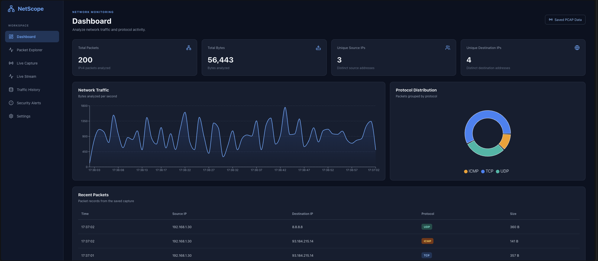
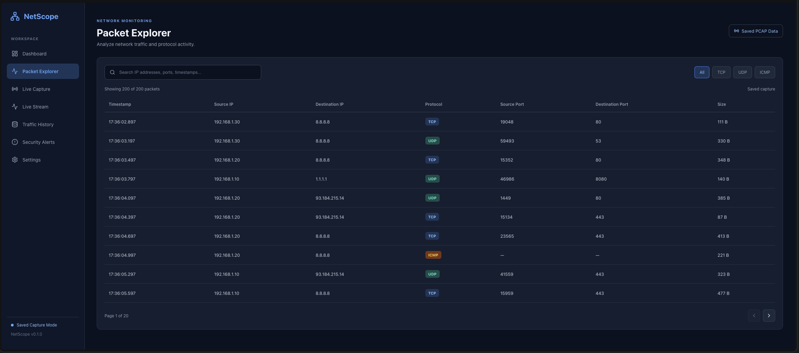
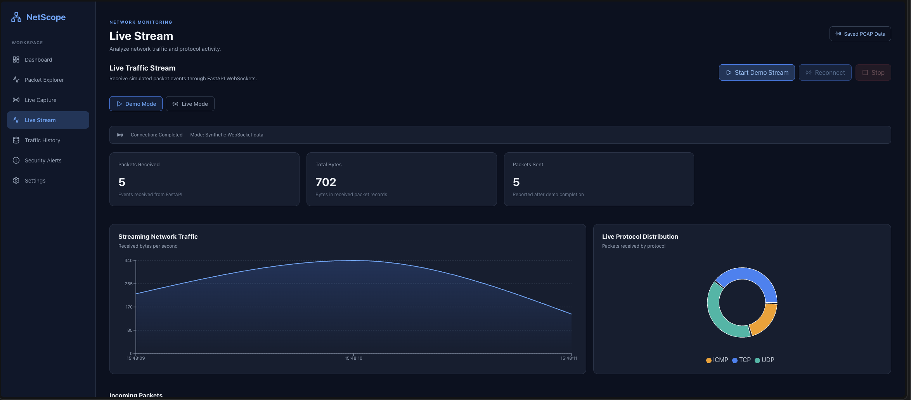
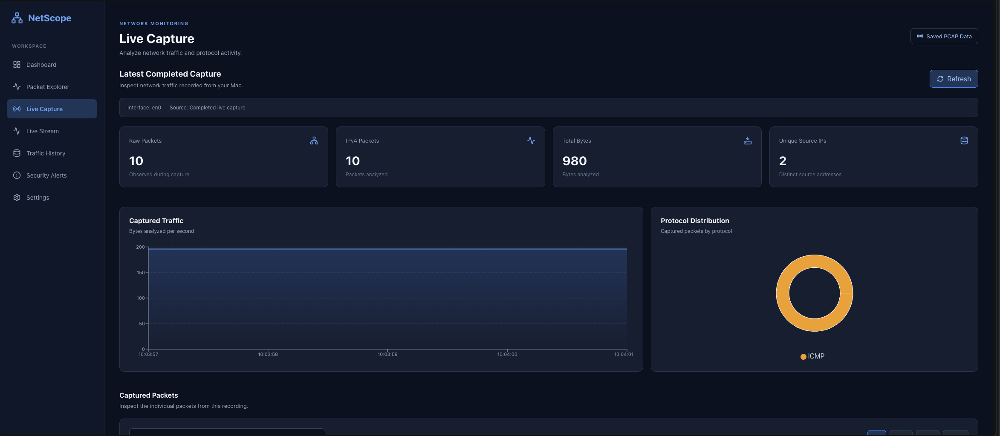
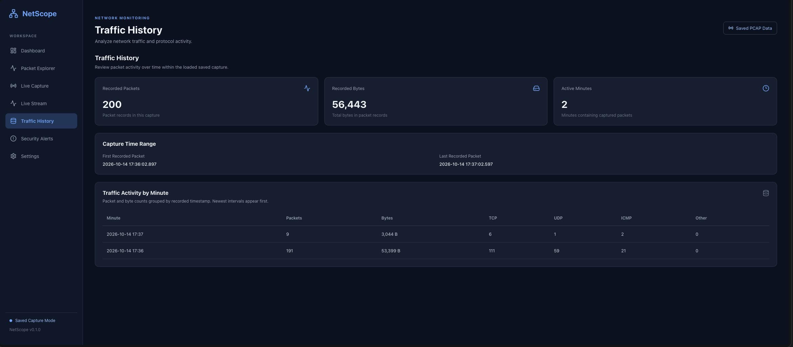
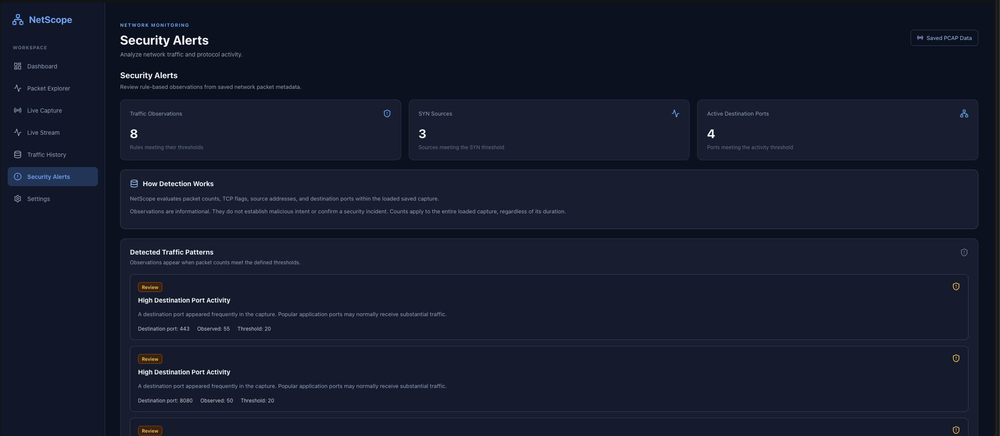
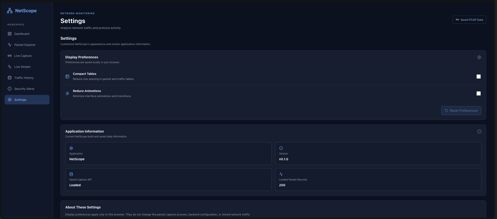

# NetScope — Network Traffic Analyzer

NetScope is a full-stack network traffic analysis application built with **Python, Scapy, FastAPI, React, and TypeScript**. It captures and analyzes network packet metadata, visualizes live traffic through WebSockets, and provides tools for exploring network activity.

The project combines packet processing, asynchronous communication, multithreading, data visualization, local socket security, and a responsive frontend.

## Features

### Network Traffic Dashboard

- View packet counts, total analyzed bytes, and unique source and destination IPs.
- Visualize traffic volume over time.
- Examine TCP, UDP, and ICMP protocol distributions.
- Inspect recent packet activity.

### Packet Explorer

- Search packet records by IP address, port, protocol, or timestamp.
- Filter traffic by TCP, UDP, and ICMP.
- Navigate paginated packet tables.
- Inspect individual packet metadata and TCP flags.

### Live Capture and Streaming

- Capture IPv4 packet metadata using Scapy.
- Forward records asynchronously through a bounded background queue.
- Deliver metadata to FastAPI through a local Unix domain socket.
- Broadcast packet events to connected React clients using WebSockets.
- View live statistics, charts, and packet records.
- Switch between synthetic Demo Mode and real Live Mode.
- Reconnect after interruptions while preserving session data.

### Traffic History

- View the time range of a saved capture.
- Group packet counts, bytes, and protocols by minute.
- Review traffic patterns within the currently loaded capture.

### Security Observations

- Identify repeated TCP SYN only activity from source addresses.
- Highlight frequently targeted destination ports.
- Detect elevated ICMP packet counts.
- Display the detection threshold, observed count, and explanation.

**Security observations are informational and do not establish malicious intent or confirm an intrusion.**

### Application Settings

- Enable compact packet tables.
- Reduce interface animations.
- Save display preferences in browser local storage.
- View application information and saved data status.

## Technology Stack

| Layer                   | Technologies                              |
| ----------------------- | ----------------------------------------- |
| Frontend                | React, TypeScript, Vite                   |
| Visualization           | Recharts                                  |
| UI icons                | Lucide React                              |
| Backend                 | Python, FastAPI                           |
| Network capture         | Scapy                                     |
| Real time communication | WebSockets, Unix domain sockets           |
| Concurrency             | Python threading, asyncio, bounded queues |
| Testing                 | pytest, TypeScript compiler, ESLint       |

## Architecture

NetScope separates privileged network capture from its web application.

**Live data flow:**

1. Scapy captures packets from a selected macOS network interface.
2. The Python analyzer converts supported packets into structured metadata.
3. A background forwarder queues and sends metadata through a Unix domain socket.
4. The FastAPI receiver validates the metadata and checks the local peer's identity.
5. The WebSocket broadcaster forwards accepted records to connected clients.
6. The React frontend updates charts, statistics, and the packet explorer.

**Saved data flow:**

Scapy capture → packet analysis → saved JSON capture → FastAPI REST endpoints → React dashboard.

The application processes packet metadata rather than exposing raw packet payloads through the web interface.

## Screenshots

### Dashboard



### Packet Explorer



### Live Stream



### Live Capture



### Traffic History



### Security Alerts



### Settings



## Getting Started

### Prerequisites

- macOS for the existing live capture and Unix socket peer verification implementation
- Python 3.13
- Node.js and npm
- Git
- Administrator privileges for live packet capture

Python 3.13 is the version used during development and testing. Other Python versions have not been verified for this release.

### 1. Clone the repository

Clone NetScope from its GitHub repository and open the project directory.

### 2. Set up the Python backend

From the repository root:

```bash
python3 -m venv .venv
source .venv/bin/activate
python -m pip install -r backend/requirements.txt
```

Create the private data directory if it does not exist:

```bash
mkdir -p data
chmod 700 data
```

The backend requires appropriate ownership and permissions for its local Unix socket files.

### 3. Start FastAPI

From the repository root:

```bash
python -m uvicorn main:app --app-dir backend --reload --reload-dir backend --host 127.0.0.1
```

FastAPI runs locally at `http://127.0.0.1:8000`.

### 4. Start the React frontend

Open a second terminal:

```bash
cd frontend
npm install
npm run dev
```

Open the local URL displayed by Vite, normally `http://localhost:5173`.

### 5. Explore NetScope

The frontend provides a Dashboard, Packet Explorer, Live Capture, Live Stream, Traffic History, Security Alerts, and Settings.

Saved capture views require available capture data. You can also use Demo Mode on the Live Stream page to receive synthetic packet events.

## Live Network Capture

Start FastAPI and React first.

Open **Live Stream → Live Mode → Start New Stream**.

From the repository root, run:

```bash
sudo .venv/bin/python backend/live_capture.py \
  --interface en0 \
  --protocol icmp \
  --timeout 30 \
  --count 20 \
  --stream
```

In another terminal, generate ICMP traffic:

```bash
ping -c 5 1.1.1.1
```

NetScope should display received ICMP metadata and update its live charts.

The `en0` interface is an example used during development. Select an interface appropriate for your computer.

Only capture traffic on networks and systems you are authorized to monitor.

## Backend Testing

Run the complete backend test suite from the repository root:

```bash
python -m pytest backend/tests/ -q
```

At the final regression testing checkpoint, **87 backend tests passed**.

The tests cover packet validation, Unix socket communication, forwarding behavior, security checks, startup recovery, and capture related functionality.

To verify the local packet receiver while FastAPI is running:

```bash
python backend/tests/test_socket_sender.py
```

## Frontend Validation

From the `frontend` directory:

```bash
npm run build
npm run lint
```

Both commands passed during release preparation testing.

## Reliability and Security

NetScope includes several safeguards:

- Validation of incoming packet metadata.
- A private Unix domain socket with restricted filesystem permissions.
- macOS peer identity verification for local socket clients.
- Exclusive receiver startup locking and verified stale-socket recovery.
- Bounded packet forwarding queues.
- Forwarding statistics for successful, failed, dropped, and in-flight records.
- Graceful shutdown with a bounded waiting period.
- Limited in memory packet retention in the Live Stream frontend.
- Structured backend logging and error reporting.

These safeguards improve reliability and local access control but do not make NetScope a production-grade security monitoring platform.

## Performance Testing

Release preparation tests included:

- Submitting 2,000 synthetic records to the packet forwarder.
- Verifying enforcement of the 500 record forwarding queue.
- Testing queue overflow and delivery accounting.
- Streaming 550 synthetic records through the FastAPI and React pipeline.

In the 550 record test, the frontend displayed **550 cumulative packet events and 66,000 bytes**, while retaining the latest **500 packet records** across 50 explorer pages.

These tests demonstrate behavior under the tested workloads, not guaranteed production throughput.

## Known Limitations

- The existing live capture and peer authentication implementation targets macOS.
- Privileged packet capture requires appropriate operating system permissions.
- The packet analyzer focuses on IPv4 metadata.
- The application does not provide packet payload inspection.
- Traffic History summarizes the currently loaded capture rather than maintaining a database of multiple sessions.
- Security observations use basic count based rules, not a full intrusion detection engine.
- The bounded forwarder can drop packet records under heavy load.
- Local browser preferences are not synchronized between devices.
- The Live Stream retains at most 500 recent records in memory, although session counters continue accumulating.
- The frontend currently requires a locally running FastAPI backend.

## Future Improvements

Possible enhancements include historical capture storage, configurable detection thresholds, improved time-window analysis, additional protocol support, frontend code splitting, and expanded automated UI testing.
